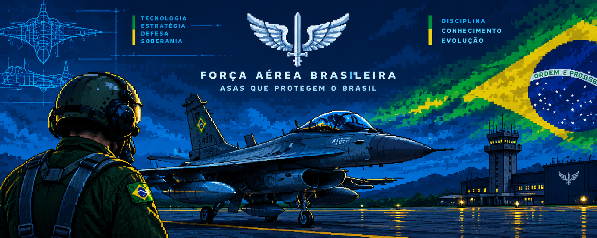

 

  

<h1 align="center">Olá! Seja bem-vindo(a) ao meu GitHub 👋</h1>

  Estudante de programação na UNIVAP, interessado em desenvolvimento de software e Aeronáutica Militar.

---

## 👨‍💻 Sobre mim

- 🎓 Estudante do ensino médio técnico na **UNIVAP — Unidade Centro, São José dos Campos**.
- 💻 Estudo e pratico programação principalmente com **C e C#**.
- 🧠 Tenho interesse em lógica de programação, algoritmos e resolução de problemas.
- 📚 Estou ampliando meus conhecimentos em diferentes linguagens e tecnologias.
- ✈️ Tenho grande interesse em **Aeronáutica Militar** e em tecnologias relacionadas à aviação.

## 🛠️ Tecnologias e ferramentas

### Linguagens que estudo e pratico com mais frequência

  
  

### Tecnologias que estou explorando

  
  
  
  
  
  
  

### Ferramentas

  
  
  

## 🚀 Projetos

Projetos que desenvolvi ou estou desenvolvendo para praticar e aprimorar minhas habilidades:

- **Sistema de estoque de mercado — C:** aplicação de console para cadastrar e consultar produtos, controlar quantidades e registrar vendas.
- **Simulador de fenômenos físicos:** projeto voltado à aplicação de conceitos de programação em simulações.
- **Ferramentas para eletricistas:** utilitários para auxiliar em cálculos e tarefas da área.
- **Calculadora de média escolar:** programa para calcular médias e praticar operações, condições e entrada de dados.

*Os links dos repositórios serão adicionados conforme os projetos forem publicados.*

## 🎯 Objetivos

- Fortalecer meus conhecimentos em algoritmos e estruturas de dados.
- Desenvolver projetos cada vez mais completos e organizados.
- Aprimorar minhas práticas de programação, testes e documentação.
- Explorar a relação entre tecnologia, engenharia e Aeronáutica Militar.

---

  <em>Sempre aprendendo, praticando e transformando ideias em projetos.</em>

